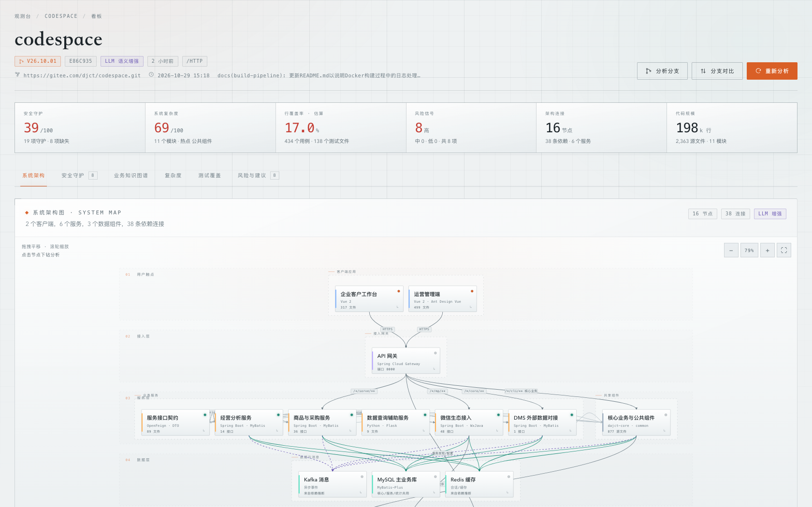
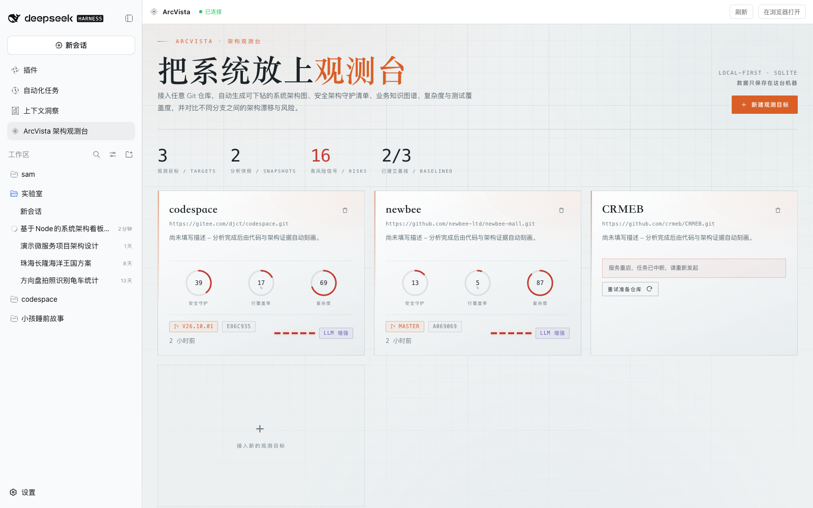
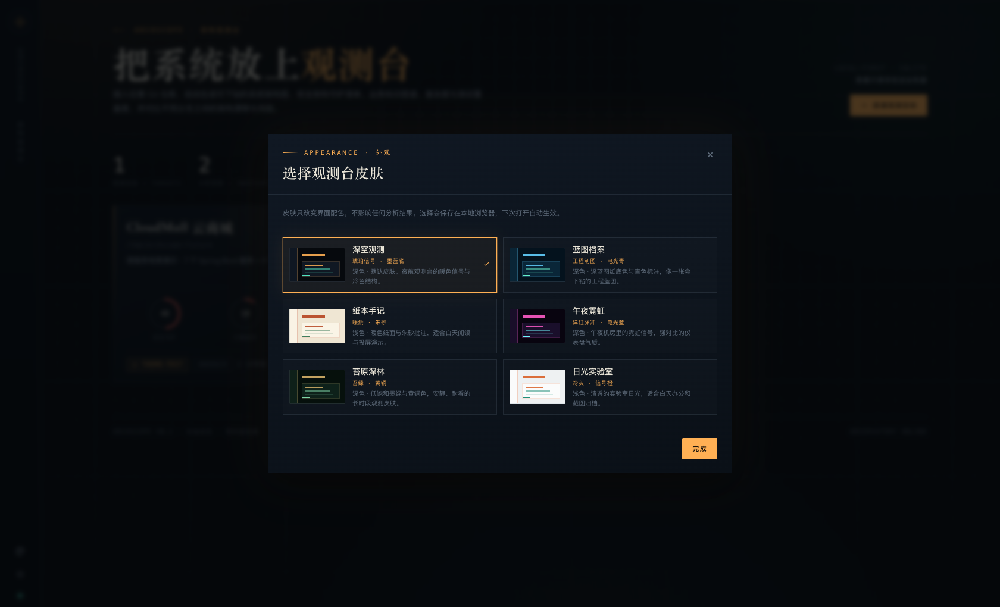
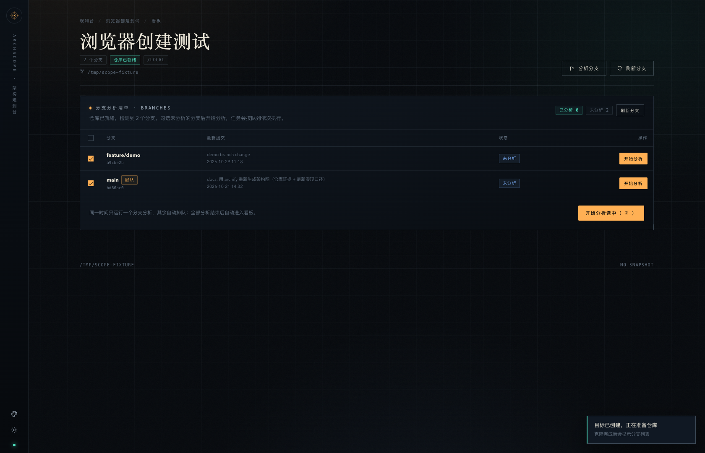
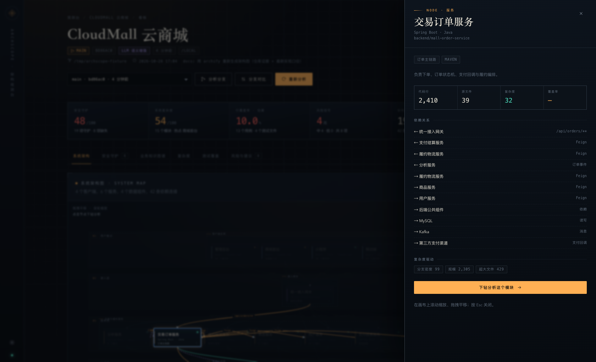
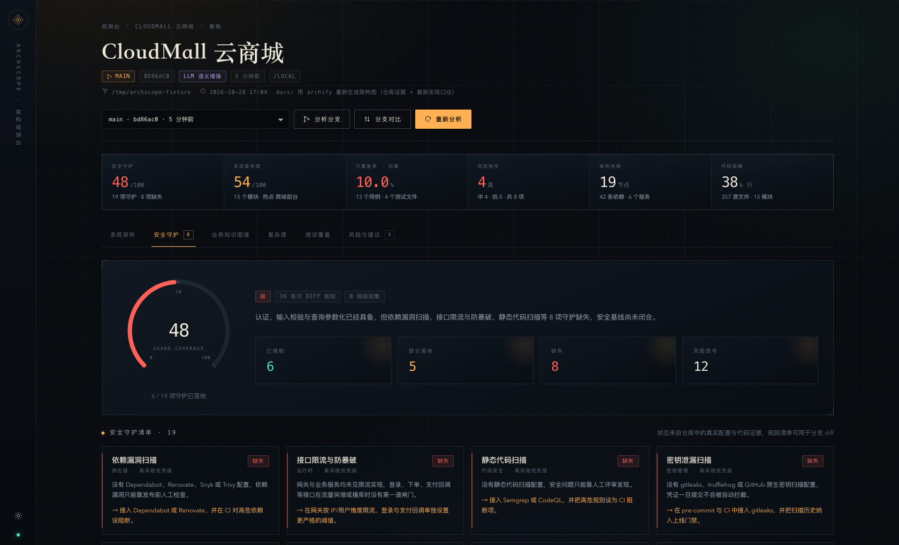
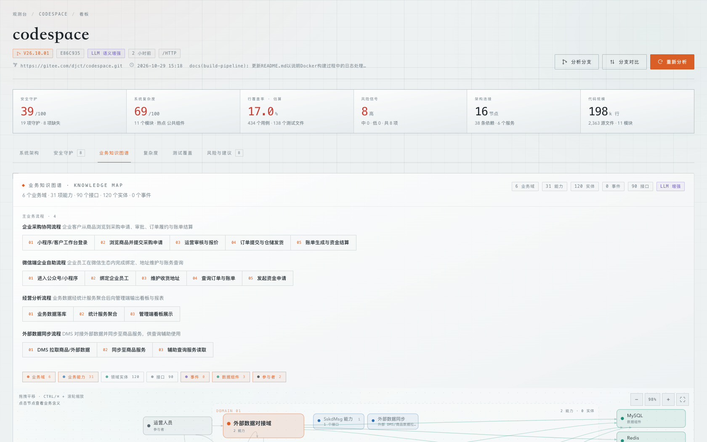
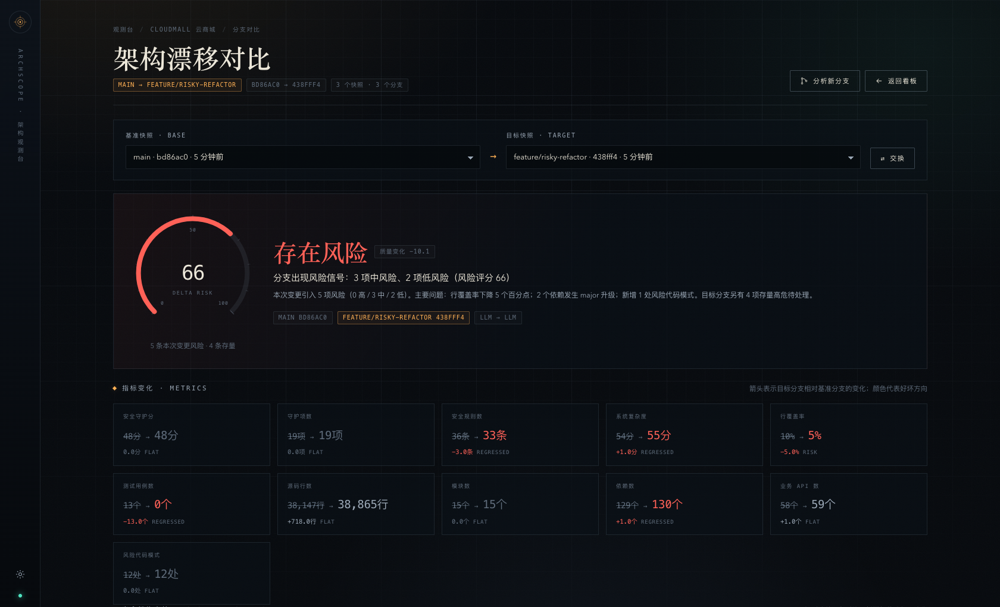

# ArcVista · 观界

本地优先的架构观测台：接入一个 Git 仓库，自动生成**可下钻的系统架构图、安全架构守护清单、业务知识图谱、复杂度与测试覆盖度**，并支持**对比不同分支之间的架构漂移与风险**。

零第三方依赖，只用 Node 22 内置的 `node:http` + `node:sqlite`，数据保存在本机 SQLite；内置 6 套可切换皮肤。



## 为什么做它

大多数代码质量工具只告诉你"哪里有问题"，但很少回答系统级的四个问题：

1. 这个系统现在**长什么样**（分层、边界、服务之间的真实调用与数据依赖）；
2. 它有哪些**架构守护**（认证、授权、注入防护、扫描规则、CI 门禁），这些规则是否可追溯；
3. 它的**业务知识**如何组织（业务域、能力、实体、事件、主流程）；
4. 换一个分支之后，架构、守护规则、依赖、复杂度和覆盖率**发生了什么变化，是否存在风险**。

ArcVista 把这些问题做成一个可以直接下钻的看板，而不是一堆静态报告。

## 作为 DSH 插件

当前仓库**根目录就是一个标准 DSH Bundle**，包名 `dsh-arcvista`。安装到 DSH profile 后，DSH 左侧会出现 **ArcVista 观界** 入口，点击即可在工作区内打开完整的 ArcVista 页面。



- **不需要单独启动 Node 服务**：ArcVista 的 API 和静态页面由 DSH Host 插件直接挂载在 `/arcvista` 路径下；
- **不需要配置模型**：分析使用 DSH 当前选择的默认模型（例如 `deepseek-flash`），模型调用通过 DSH 的 `llm` 服务完成；设置页会自动隐藏原来的模型 / API Key 配置；
- 数据仍保存在本机：默认写在 `~/.dsh/arcvista/`（SQLite、备份和仓库镜像），不会写进 `node_modules`；
- 面板顶部显示运行状态，右上角可以刷新或在独立浏览器窗口打开；
- 主题跟随 DSH 的浅色 / 深色模式（映射到 `daylight` / `obsidian`），内嵌页面隐藏了 ArcVista 原来的左侧栏；
- 插件随 DSH 启动而加载，无需手动维护端口或进程。

### 安装

从 GitHub 镜像安装（推荐，固定 Commit 更安全）：

```bash
dsh plugin --profile web add https://github.com/yonking305/arc-vista.git
```

发布到 npm 后也可以直接安装：

```bash
dsh plugin --profile web add dsh-arcvista
```

本地开发：

```bash
dsh plugin --profile web add /absolute/path/to/arc-vista
```

### 发布与商店

- 发布包名：`dsh-arcvista`
- 仓库：<https://gitee.com/rogue-raiders/arc-vista>
- 当前声明兼容 DSH：`0.2.0-rc.2`
- 待办：DSH-Store 目前只收录 **GitHub** 仓库，Gitee 源需要同步一个公开的 GitHub 镜像后再提交上架 Issue。

> 插件 Host 代码更新后需要重启一次 DSH 才会加载新模块；只改页面样式 / 前端逻辑时刷新页面即可。

### 权限与数据

这个插件会在 DSH Host 进程里执行以下操作，安装前请确认：

- 用 `git` 克隆 / 拉取被观测仓库，读取工作区文件，生成静态分析结果；
- 在 DSH profile 的 `arcvista/` 下写 SQLite、备份和任务状态；
- 通过 DSH 的 `llm` 服务调用当前默认模型做语义增强；
- 在 DSH Web 服务器注册 `/arcvista` 路由，用于面板和 API。

不包含 `install` / `prepare` 等生命周期脚本，不修改 DSH 核心，不占用 `@deepseek-ai/*` 命名空间。

## 快速开始

要求：Node.js **>= 22.5**（使用内置 `node:sqlite`），本机安装 `git`。

```bash
cd arc-vista
npm start
```

打开 <http://127.0.0.1:4321>，点击「新建观测目标」，填入：

- 产品名称；
- Git 仓库地址（支持 `https://` / `ssh://` / `git@` / 本地绝对路径）；
- 可选分支与描述。

创建后会先在后台克隆 / 拉取仓库，完成后进入产品的「分支分析清单」：勾选要分析的分支（可多选）后开始分析，任务会按队列依次执行，全部分析完成后进入看板。

> 不需要 `npm install`：项目没有任何运行时依赖。第一次分析需要能访问仓库地址。

## 皮肤

内置 6 套皮肤，左下角的调色盘按钮即可切换，也可以在产品设置页里预览选择：

| 皮肤 | 风格 |
| --- | --- |
| 深空观测（默认） | 墨蓝底 + 琥珀信号灯，夜航观测台气质 |
| 蓝图档案 | 深蓝工程图纸 + 电光青标注 |
| 纸本手记 | 暖纸 + 朱砂批注，浅色，适合白天阅读与投屏 |
| 午夜霓虹 | 洋红 + 电光蓝，高对比机房霓虹 |
| 苔原深林 | 墨绿 + 黄铜，低饱和长时段观色 |
| 日光实验室 | 冷灰 + 信号橙，浅色、干净、适合截图归档 |



皮肤只改变界面配色，不影响任何分析结果；选择保存在浏览器 `localStorage`，刷新与重新打开都会保留。架构图、知识图谱、图表和绘制的颜色都通过主题变量驱动，切换时无需重新分析或刷新页面。

## 功能

### 0. 仓库准备与分支分析清单



- 新建产品后先显示克隆 / 拉取进度，完成后自动刷新出分支清单；
- 每个分支显示最新提交、是否已分析、分析中 / 排队中 / 上次失败等状态；
- 可勾选多个未分析分支批量开始，任务按队列依次执行；
- 已分析分支可以直接「查看看板」或「重新分析」；
- 全部分析完成后自动进入看板，也可以随时从看板右上角「分析分支」打开清单。

### 1. 系统架构图（可下钻）



- 由仓库结构、构建清单、网关路由、Feign 声明、编排配置与依赖推断生成的分层架构图：客户端 → 接入层 → 服务层 → 数据层 → 基础设施 / 外部系统。
- 拖拽平移、滚轮缩放、节点悬停高亮依赖链路；点击节点打开节点详情（指标、复杂度驱动、上下游依赖、下钻入口）。
- **下钻分析**：进入单个模块的内部结构（按 Controller / Service / Domain / DTO / 事件 / 配置等职责聚合的依赖子图）、关键流程、对外接口、调用方/被依赖方、数据组件、模块风险与改进建议；支持继续追问该模块。
- 配置大模型后，架构的命名、业务职责、外部系统与连接会由模型基于代码证据做语义增强；没有模型时启发式结果同样完整可用。

### 2. 安全架构守护



- 19 类守护族：身份认证、授权/RBAC、输入校验、注入防护、传输加密、CORS、CSRF、限流、SAST、依赖扫描、密钥扫描、硬编码密钥、审计日志、依赖锁定、容器安全、安全响应头、安全测试等。
- 每项守护给出 `enforced / partial / missing` 状态、规则清单、证据文件与行号、改进建议。
- 解析 `semgrep`、ESLint 安全规则、CodeQL、SonarQube、gitleaks、Dependabot、Renovate、Snyk、Trivy、Dockerfile、lockfile、Spring Security / JWT / MyBatis / helmet / express-rate-limit 等真实配置。
- 规则清单是**可 diff 的**：分支对比会逐条列出新增和移除的规则。

### 3. 业务知识图谱



- 业务域来自服务边界；能力来自 Controller 聚合；实体来自领域模型；事件来自 Kafka / RabbitMQ 主题与监听器；数据组件来自依赖与编排配置；参与者来自客户端入口。
- 卡片式业务域泳道：业务能力、领域实体、事件、数据组件、参与者分别用不同类型卡片呈现；接口与领域实体默认收起避免过密，可在筛选器中展开。
- 普通滚动只滚动页面，`Ctrl/⌘ + 滚轮`或工具条缩放；点击节点查看业务含义，并从业务域下钻到对应代码模块。
- 配置大模型后自动补充业务语义、业务能力、主业务流程（如"下单 → 支付 → 扣减库存 → 发货签收"）与跨域事实。

### 4. 复杂度

- 系统复杂度评分 + 模块级矩阵：LOC、文件数、平均/最大文件行数、分支密度、扇入/扇出、Git 变更频率。
- 识别复杂度热点、给出可执行的治理建议；前端 CSS/SCSS 等样式文件不计入复杂度评分。
- 雷达图展示系统形态（规模、文件粒度、耦合、变更热度、测试缺口）。

### 5. 测试覆盖

- 优先解析真实覆盖率产物：`coverage/coverage-summary.json`、`lcov.info`、JaCoCo `jacoco.xml`、Cobertura `coverage.xml`、`.nyc_output`。
- 没有产物时使用明确标注的**估算值**（测试/源码 LOC 比、测试文件比、用例数、零测试模块），并在界面和风险条目中说明局限。
- 展示测试用例数、测试文件、模块覆盖、未覆盖模块与大文件、测试缺口清单。

### 6. 分支对比与风险判断



选择任意两个快照（通常来自两个分支）进行对比：

- **结论**：整体改善 / 基本稳定 / 需要关注 / 存在风险，附质量变化分与增量风险分。
- **指标变化**：安全分、守护规则数、系统复杂度、行覆盖率、测试用例数、代码规模、模块数、依赖数、业务 API 数、风险代码模式。
- **安全守护 diff**：新增/移除守护、状态变化、规则集逐条增删。
- **依赖 diff**：新增/移除依赖、版本升级（major 标记）、降级。
- **复杂度 / 覆盖率 diff**：模块级升降排名、新增未测试文件、测试用例减少。
- **架构与业务 diff**：架构节点增减、业务域/实体/接口/事件变化。
- **风险清单**：只把本次变更引入的风险计入结论；目标分支的历史高危单独列为"存量风险"，避免把老问题算到新分支头上。

## 配置大模型

支持所有 OpenAI 兼容接口（DeepSeek / OpenAI / Moonshot / 通义千问 / 本地 Ollama 等）。

在页面左下角进入「模型设置」，填写 Base URL、模型名与 API Key，可一键测试连接。也可以用环境变量启动，环境变量优先级更高：

```bash
ARCVISTA_LLM_API_KEY=sk-xxx \
ARCVISTA_LLM_BASE_URL=https://api.deepseek.com/v1 \
ARCVISTA_LLM_MODEL=deepseek-chat \
npm start
```

模型会被用于：

- 架构图的业务命名、分层语义、外部系统补全；
- 业务知识图谱的业务域/能力/流程；
- 基于指标的架构风险与治理建议；
- 模块下钻的职责说明、内部结构与追问回答。

**没有配置 Key 也能完整使用**：架构、依赖、安全守护、复杂度、覆盖率、知识图谱全部由静态分析引擎生成，风险规则照常运行。快照会记录当次使用的引擎（`LLM 语义增强` / `启发式`）。

## 工作方式

```
Git 仓库 ──► 本地镜像（bare）──► 按提交检出 worktree
                                      │
        ┌─────────────────────────────┼──────────────────────────────┐
        ▼                             ▼                              ▼
   文件/模块/依赖图            安全守护扫描                    覆盖率产物解析
        │                             │                              │
        ├──────────────┬──────────────┴──────────────┬───────────────┤
        ▼              ▼                             ▼               ▼
   架构模型        知识图谱                      复杂度          风险规则
        └──────────────┴──────────► 可选 LLM 语义增强 ◄─────────────┘
                                      │
                                      ▼
                            快照（SQLite）+ 分支 diff
```

- 仓库以 bare mirror 形式缓存在 `data/repos/`，按提交创建临时 worktree，分析完成后只保留最近用到的 worktree；**不会修改你的仓库**。
- 每次分析生成一个不可变快照，包含完整分析 JSON、指标摘要、提交信息与引擎信息。
- 分支对比基于快照计算，不依赖实时重分析。

## Git 超时与断点续传

大仓库首次克隆可能很慢。克隆、拉取与检出遇到**超时或网络错误会自动重试**（默认共 4 次，退避等待 2s / 4s / 6s）：

- 克隆中断时会保留已经下载的数据，下一次尝试自动改为 `git fetch` **断点续传**，而不是从头再克隆；
- 记录每次重试的原因与次数，可在任务日志中看到（"克隆失败（操作超时），2.0s 后自动重试（第 2/4 次）"）；
- 网络长时间不可用导致最终失败时，任务卡片会提示可点「重试分析」继续续传，已下载的镜像不会丢弃；
- 克隆、拉取、检出的超时时间与重试次数都可以用下方环境变量调整，例如大仓库可以调大 `ARCVISTA_GIT_CLONE_TIMEOUT_MS`。

## 数据、备份与隐私

- 所有数据（产品、快照、下钻缓存、设置）保存在 `data/arcvista.db`（SQLite）。
- 仓库镜像与检出代码在 `data/repos/`、`data/worktrees/`，可随时删除，重新分析会重建。
- **自动备份**：启动时、每次分析完成以及删除产品前，会把 SQLite 快照写入 项目根目录的 `backups/`（默认保留 12 份，文件权限 600；可用 `ARCVISTA_BACKUP_DIR` 修改位置，`ARCVISTA_BACKUP_KEEP` 修改保留数量）。
- **自动恢复**：如果 `data/arcvista.db` 缺失或无法打开，启动时会自动从最近一份包含产品的备份恢复，并在启动日志和设置页提示恢复来源。
- 设置页「当前状态」可以看到数据目录、备份目录和最近备份时间，也可以点「立即备份数据」手动备份。
- 仓库镜像体积可能较大；备份只包含数据库（产品、快照、设置），不会重复备份仓库镜像。
- API Key 只写入本地 SQLite（也会进入上述备份文件，文件权限 600，仅保存在本机），接口返回时脱敏；服务仅监听 `127.0.0.1`。
- 只有配置大模型并执行分析时，才会把**仓库证据摘要**（模块、依赖、路由、配置、指标等，不含完整源码）发送给你配置的模型服务。

## 环境变量

| 变量 | 默认值 | 说明 |
| --- | --- | --- |
| `PORT` | `4321` | 服务端口 |
| `HOST` | `127.0.0.1` | 监听地址 |
| `ARCVISTA_DATA` | `./data` | 数据目录 |
| `ARCVISTA_BACKUP_DIR` | `./backups`（data 的同级目录） | 数据库自动备份目录 |
| `ARCVISTA_BACKUP_KEEP` | `12` | 备份保留份数 |
| `ARCVISTA_NO_AUTO_RESTORE` | — | 设为 `1` 时禁止数据库缺失时自动恢复 |
| `ARCVISTA_GIT_RETRIES` | `4` | 克隆/拉取/检出失败时的总尝试次数 |
| `ARCVISTA_GIT_RETRY_DELAY_MS` | `2000` | Git 重试的基础退避时间（毫秒） |
| `ARCVISTA_GIT_CLONE_TIMEOUT_MS` | `900000` | 单次克隆超时（默认 15 分钟） |
| `ARCVISTA_GIT_FETCH_TIMEOUT_MS` | `300000` | 单次拉取超时（默认 5 分钟） |
| `ARCVISTA_GIT_WORKTREE_TIMEOUT_MS` | `300000` | 单次检出超时（默认 5 分钟） |
| `ARCVISTA_LLM_API_KEY` | — | 大模型 API Key（优先于页面设置） |
| `ARCVISTA_LLM_BASE_URL` | — | 大模型 Base URL |
| `ARCVISTA_LLM_MODEL` | — | 模型名 |
| `ARCVISTA_DEBUG` | — | 打印异常堆栈 |

## API 一览

| 方法 | 路径 | 说明 |
| --- | --- | --- |
| `GET` | `/api/products` | 产品列表（含最新快照与任务状态） |
| `POST` | `/api/products` | 创建产品并自动开始分析 |
| `GET` | `/api/products/:id` | 产品详情、快照、分支、任务 |
| `POST` | `/api/products/:id/analyze` | 分析分支（`branch`、`force`） |
| `GET` | `/api/products/:id/snapshots/:sid` | 快照完整分析结果 |
| `POST` | `/api/products/:id/modules/analyze` | 模块下钻（异步任务） |
| `GET` | `/api/products/:id/compare` | 分支/快照对比 |
| `GET` | `/api/jobs/:id` | 任务进度与日志 |
| `GET/PUT` | `/api/settings` | 模型配置 |
| `POST` | `/api/settings/test` | 测试模型连接 |

## 目录结构

```
arcvista/
├── server.js                 # HTTP 服务与 API 路由
├── lib/
│   ├── analyze/              # 静态分析引擎
│   │   ├── walk.js           # 文件扫描（排除构建产物/依赖目录）
│   │   ├── modules.js        # 模块边界识别
│   │   ├── graph.js          # 导入/依赖图
│   │   ├── deps.js           # 构建清单依赖解析（npm/maven/gradle/pip/go）
│   │   ├── security.js       # 安全架构守护
│   │   ├── coverage.js       # 覆盖率产物解析与估算
│   │   ├── complexity.js     # 复杂度
│   │   ├── architecture.js   # 架构模型
│   │   ├── knowledge.js      # 业务知识图谱
│   │   ├── evidence.js       # 路由/实体/事件/Feign/编排证据抽取
│   │   ├── enrich.js         # LLM 语义增强与启发式风险
│   │   ├── drilldown.js      # 模块下钻
│   │   └── index.js          # 分析编排
│   ├── diff.js               # 快照对比与风险规则
│   ├── git.js                # mirror / worktree / 分支 / churn
│   ├── db.js                 # SQLite
│   ├── jobs.js               # 后台任务
│   ├── llm.js                # OpenAI 兼容客户端
│   └── http.js               # 极小 HTTP 框架
├── public/                   # 零构建前端（原生 ES Modules + SVG）
│   ├── css/
│   └── js/
├── docs/
│   ├── analyzer-contract.md  # 内部分析器契约
│   └── screenshots/
├── tests/                    # node:test 冒烟测试
└── data/                     # 运行时生成（gitignore）
```

## 开发与测试

```bash
npm test        # 使用 node:test 运行分析器与 diff 的冒烟测试
npm run dev     # node --watch 热重启
```

前端是原生 ES Modules + SVG，没有构建步骤；修改 `public/` 后刷新即可。

## 已知边界

- 覆盖率优先使用仓库中的真实产物；没有产物时是**估算值**，只能用于判断覆盖明显偏低或缺失，不能当作真实覆盖率。
- 安全守护与风险模式是启发式识别，结论会附证据路径，但仍建议人工复核。
- 架构中的服务间调用来自网关路由、Feign 声明、导入关系与配置推断；运行期的动态调用（如反射、消息路由）可能无法完全还原。
- 仓库扫描有文件数与单文件大小上限（默认 2 万文件 / 1.2MB），超大 monorepo 可调整 `scanRepo` 参数。
- 私有仓库需要本机 git 凭据（SSH key 或 credential helper）可用。
- 分支对比的语义依赖守护规则 ID、模块路径、API 路径的稳定性；大范围重命名会被视为删除 + 新增。
- LLM 增强需要网络与模型费用；失败会自动回退到启发式分析并在快照中记录提示。

## 与 Archify 的关系

架构图能力借鉴了 [Archify](../../.agents/skills/archify) 的分层表达与交互思路（分层、边界、图例、下钻），但 ArcVista 把它放进了持续观测的产品看板：仓库即数据源、快照可对比、结论可追溯，并增加了安全守护、知识图谱、复杂度、覆盖率与分支风险判断。


## License

MIT
