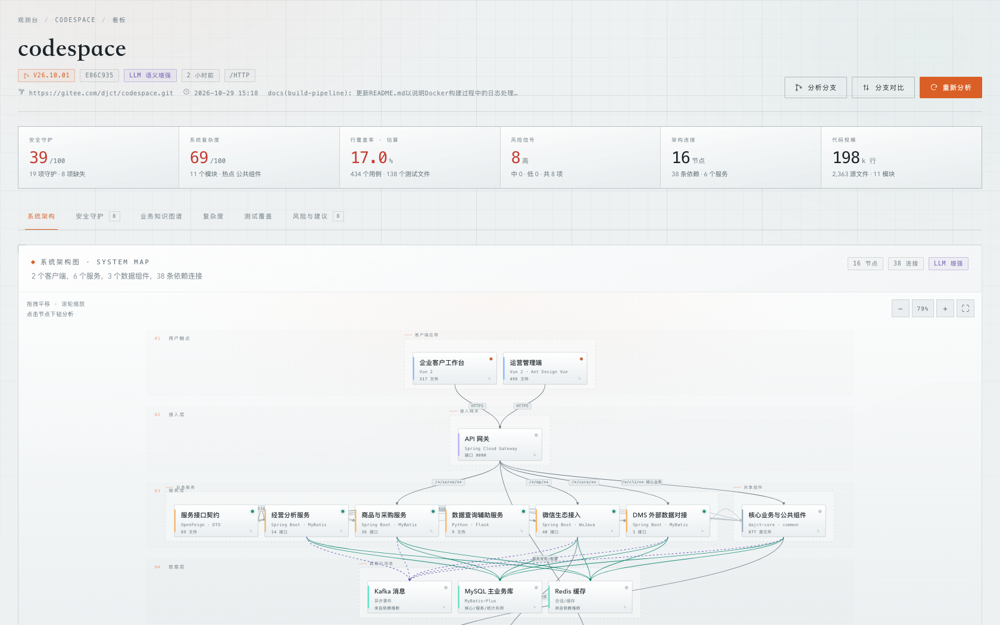
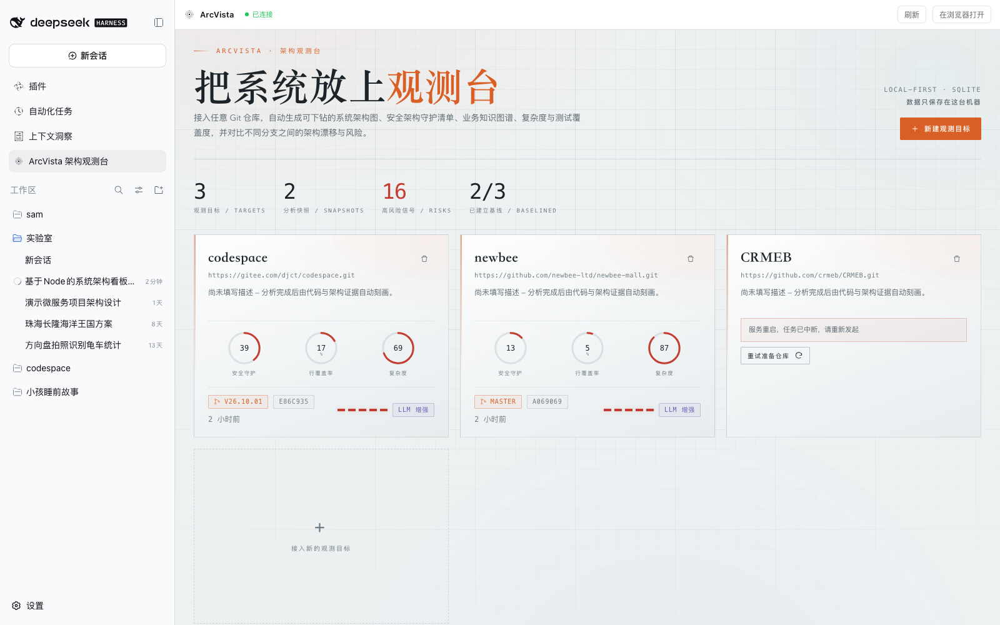
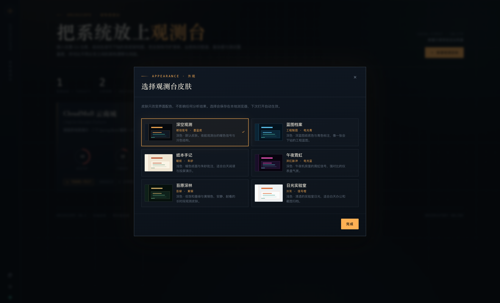
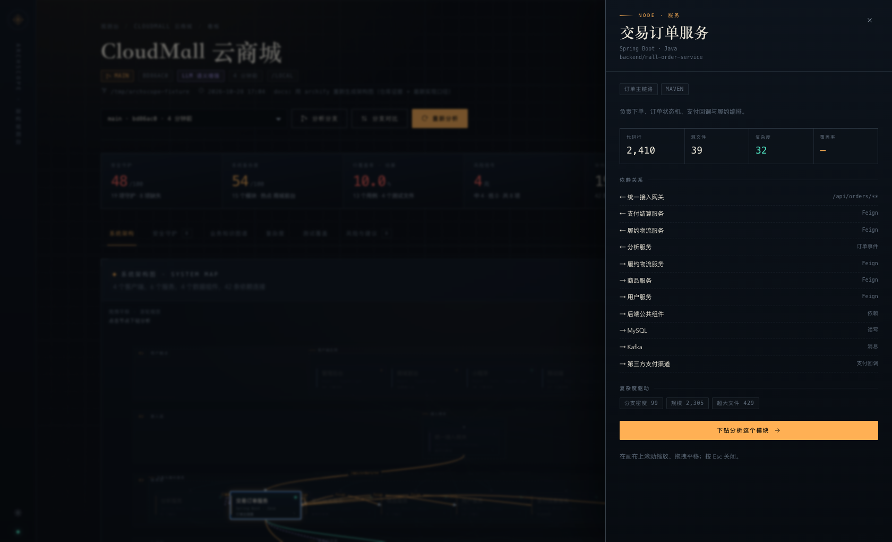
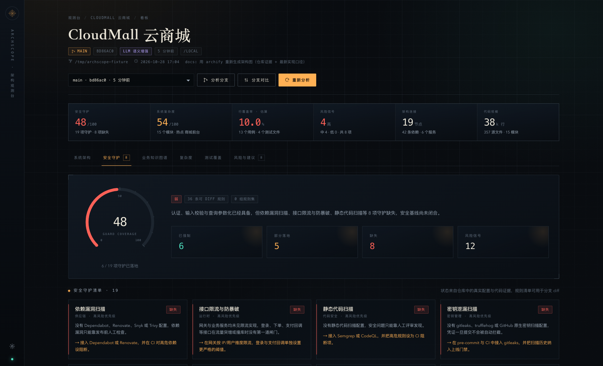
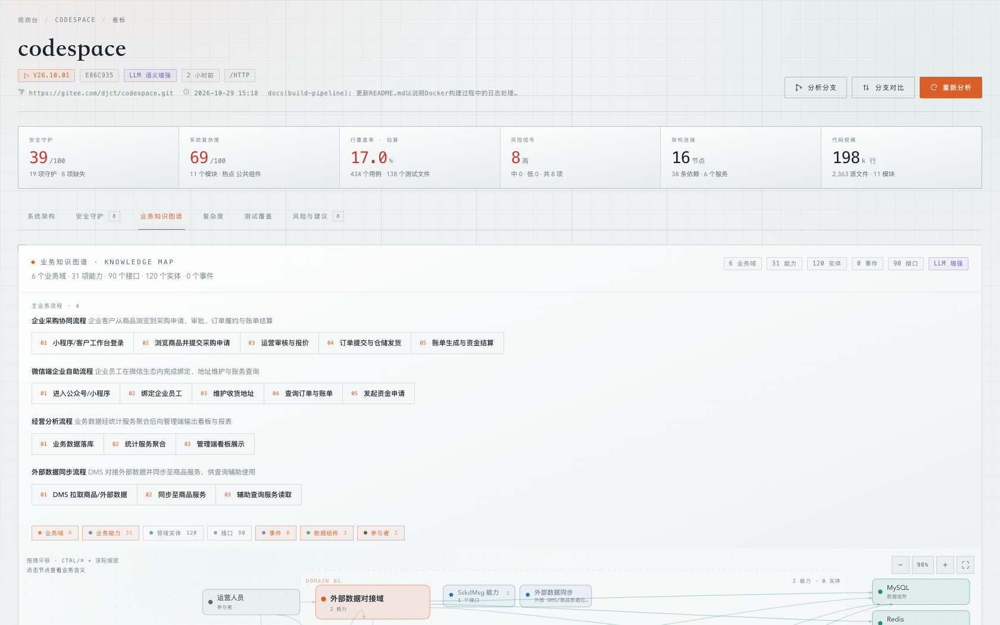
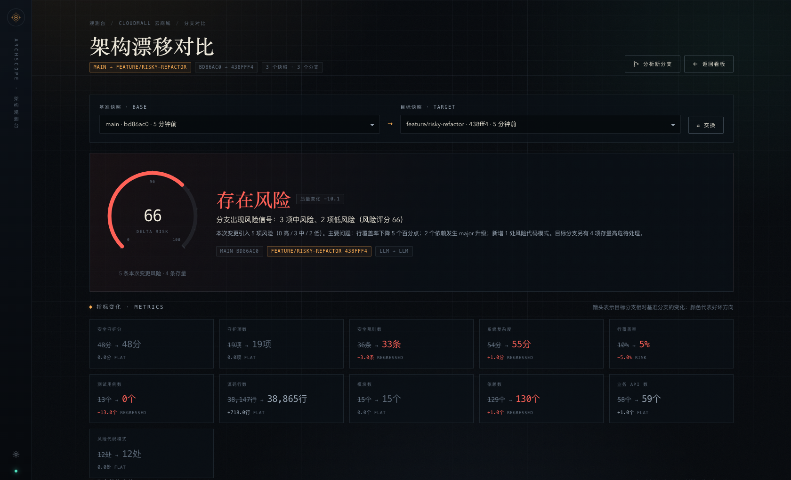

# ArcVista · 观界

本地优先的架构观测台：选择一个本地项目目录，自动生成**可下钻的系统架构图、安全架构守护清单、业务知识图谱、复杂度与测试覆盖度**，并支持**对比不同快照之间的架构漂移与风险**。

零第三方依赖，只用 Node 22 内置的 `node:http` 与本地 JSON 文件；项目列表在插件数据目录，分析产出在项目自己的 `.arcvista/` 目录。内置 6 套可切换皮肤。



## 为什么做它

大多数代码质量工具只告诉你"哪里有问题"，但很少回答系统级的四个问题：

1. 这个系统现在**长什么样**（分层、边界、服务之间的真实调用与数据依赖）；
2. 它有哪些**架构守护**（认证、授权、注入防护、扫描规则、CI 门禁），这些规则是否可追溯；
3. 它的**业务知识**如何组织（业务域、能力、实体、事件、主流程）；
4. 重新分析当前工作区之后，架构、守护规则、依赖、复杂度和覆盖率**发生了什么变化，是否存在风险**。

ArcVista 把这些问题做成一个可以直接下钻的看板，而不是一堆静态报告。

## 作为 DSH 插件

当前仓库**根目录就是一个标准 DSH Bundle**，包名 `dsh-arcvista`。安装到 DSH profile 后，DSH 左侧会出现 **ArcVista 观界** 入口，点击即可在工作区内打开完整的 ArcVista 页面。



- **不需要单独启动 Node 服务**：ArcVista 的 API 和静态页面由 DSH Host 插件直接挂载在 `/arcvista` 路径下；
- **不需要配置模型**：分析使用 DSH 当前选择的默认模型（例如 `deepseek-flash`），模型调用通过 DSH 的 `llm` 服务完成；设置页不提供模型配置；
- 数据仍保存在本机：项目列表、任务与设置写在 `~/.dsh/arcvista/`；分析快照写在每个项目的 `.arcvista/`；
- 面板顶部显示运行状态，右上角可以刷新或在独立浏览器窗口打开；
- 主题跟随 DSH 的浅色 / 深色模式（映射到 `daylight` / `obsidian`），内嵌页面隐藏了 ArcVista 原来的左侧栏；
- 插件随 DSH 启动而加载，无需手动维护端口或进程。

### 安装

从 GitHub 安装（推荐，固定 Commit 更安全）：

```bash
dsh plugin --profile web add https://github.com/yonking305/arc-vista.git
```

发布到 npm 后也可以直接安装：

```bash
dsh plugin --profile web add dsh-arcvista
```

本地开发：

```bash
dsh plugin --profile web add /absolute/path/to/arc-vista
```

### 打包 TGZ

生成可分发的 DSH 插件 tarball（含 SHA-256 和 manifest）：

```bash
npm run package:tgz
# dist/dsh-arcvista-<version>.tgz
# dist/dsh-arcvista-<version>.tgz.sha256
# dist/dsh-arcvista-<version>.manifest.json
```

也可以双击项目根目录的 `打包 TGZ.command`。安装生成的包：

```bash
dsh plugin --profile web add /absolute/path/to/dsh-arcvista-<version>.tgz
```

### 内网离线安装

内网（无外网、无 npm registry）环境使用离线安装包，由仓库内的构建脚本生成：

```bash
npm run package:intranet   # 生成 ../arc-vista-intranet-installer/ 与 ../arc-vista-intranet-installer.zip
```

把 zip 拷进内网后解压：

- Windows：双击 `install.bat`；
- macOS：双击 `install.command`；
- 任意平台：`node install.mjs`（加 `--dry-run` 先看计划，`--verify` 检查状态，`--uninstall` 卸载）。

安装器只做本地文件复制与 DSH profile 注册，不联网、不需要 pnpm；离线 tarball 会留在 profile 的
`.dsh-offline-plugins/` 里，之后用 pnpm 也能离线解析。装完重启 DSH Web，左侧栏出现「ArcVista 观界」。
安装包自身说明见 `packaging/intranet/README.md`。

内网安全团队需要审查时，生成配套的安全审查材料包：

```bash
npm run package:security-review
# 生成 ../arc-vista-security-review/ 与 ../arc-vista-security-review.zip
# 含文件清单、SHA-256、SBOM、静态扫描证据、可复现构建步骤与审批申请模板
```

### 发布与商店

- 发布包名：`dsh-arcvista`
- 仓库：<https://github.com/yonking305/arc-vista>
- 当前声明兼容 DSH：`0.2.0-rc.2`

> 插件 Host 代码更新后需要重启一次 DSH 才会加载新模块；只改页面样式 / 前端逻辑时刷新页面即可。

### 权限与数据

这个插件会在 DSH Host 进程里执行以下操作，安装前请确认：

- 读取用户选择的本地项目目录（只读源码）；如果目录是 Git 仓库，会调用本机 `git` 读取当前分支、提交与变更热度；
- 在全局插件目录 `~/.dsh/arcvista/` 写项目列表、任务与设置；在项目内 `.arcvista/` 写分析快照与下钻缓存；
- 通过 DSH 的 `llm` 服务调用当前默认模型做语义增强；
- 在 DSH Web 服务器注册 `/arcvista` 路由，用于面板和 API。

不包含 `install` / `prepare` 等生命周期脚本，不修改 DSH 核心，不占用 `@deepseek-ai/*` 命名空间。

## 快速开始

要求：Node.js **>= 22.19**，本机安装 `git`（可选；非 Git 目录也能分析）。

```bash
cd arc-vista
npm start
```

打开 <http://127.0.0.1:4321>，点击「新建本地项目」，填入：

- 产品名称（可留空，默认取目录名）；
- 本地项目目录的绝对路径；DSH 插件里也可以直接从已登记的工作区选择；
- 可选描述。

创建后会立即分析当前工作区，不需要克隆、拉取或手动准备仓库。分析产出写入项目内的 `.arcvista/`。

> 不需要 `npm install`：项目没有任何运行时依赖。

## 皮肤

内置 6 套皮肤，左下角的调色盘按钮即可切换，也可以在产品设置页里预览选择：

| 皮肤 | 风格 |
| --- | --- |
| 深空观测（默认） | 墨蓝底 + 琥珀信号灯，夜航观测台气质 |
| 蓝图档案 | 深蓝工程图纸 + 电光青标注 |
| 纸本手记 | 暖纸 + 朱砂批注，浅色，适合白天阅读与投屏 |
| 午夜霓虹 | 洋红 + 电光蓝，高对比机房霓虹 |
| 苔原深林 | 墨绿 + 黄铜，低饱和长时段观色 |
| 日光实验室 | 冷灰 + 信号橙，浅色、干净、适合截图归档 |



皮肤只改变界面配色，不影响任何分析结果；选择保存在浏览器 `localStorage`，刷新与重新打开都会保留。架构图、知识图谱、图表和绘制的颜色都通过主题变量驱动，切换时无需重新分析或刷新页面。

## 功能

### 0. 本地项目接入

- 新建项目时填写本地目录绝对路径，DSH 插件模式下可以直接选择已登记的工作区；
- 创建后立即分析当前工作区，不克隆、不拉取、不切换分支；
- 可以随时重新分析，生成新的快照；
- 项目列表、任务与设置保存在全局插件目录，分析产出保存在项目自己的 `.arcvista/`。

### 1. 系统架构图（可下钻）



- 由项目结构、构建清单、网关路由、Feign 声明、编排配置与依赖推断生成的分层架构图：客户端 → 接入层 → 服务层 → 数据层 → 基础设施 / 外部系统。
- 拖拽平移、滚轮缩放、节点悬停高亮依赖链路；点击节点打开节点详情（指标、复杂度驱动、上下游依赖、下钻入口）。
- **下钻分析**：进入单个模块的内部结构（按 Controller / Service / Domain / DTO / 事件 / 配置等职责聚合的依赖子图）、关键流程、对外接口、调用方/被依赖方、数据组件、模块风险与改进建议；支持继续追问该模块。
- 模型由 DSH 统一提供，架构的命名、业务职责、外部系统与连接会基于代码证据做语义增强；没有模型时启发式结果同样完整可用。

### 2. 安全架构守护



- 19 类守护族：身份认证、授权/RBAC、输入校验、注入防护、传输加密、CORS、CSRF、限流、SAST、依赖扫描、密钥扫描、硬编码密钥、审计日志、依赖锁定、容器安全、安全响应头、安全测试等。
- 每项守护给出 `enforced / partial / missing` 状态、规则清单、证据文件与行号、改进建议。
- 解析 `semgrep`、ESLint 安全规则、CodeQL、SonarQube、gitleaks、Dependabot、Renovate、Snyk、Trivy、Dockerfile、lockfile、Spring Security / JWT / MyBatis / helmet / express-rate-limit 等真实配置。
- 规则清单是**可 diff 的**：快照对比会逐条列出新增和移除的规则。

### 3. 业务知识图谱



- 业务域来自服务边界；能力来自 Controller 聚合；实体来自领域模型；事件来自 Kafka / RabbitMQ 主题与监听器；数据组件来自依赖与编排配置；参与者来自客户端入口。
- 卡片式业务域泳道：业务能力、领域实体、事件、数据组件、参与者分别用不同类型卡片呈现；接口与领域实体默认收起避免过密，可在筛选器中展开。
- 普通滚动只滚动页面，`Ctrl/⌘ + 滚轮`或工具条缩放；点击节点查看业务含义，并从业务域下钻到对应代码模块。
- 模型由 DSH 统一提供，自动补充业务语义、业务能力、主业务流程（如"下单 → 支付 → 扣减库存 → 发货签收"）与跨域事实。

### 4. 复杂度

- 系统复杂度评分 + 模块级矩阵：LOC、文件数、平均/最大文件行数、分支密度、扇入/扇出、Git 变更频率。
- 识别复杂度热点、给出可执行的治理建议；前端 CSS/SCSS 等样式文件不计入复杂度评分。
- 雷达图展示系统形态（规模、文件粒度、耦合、变更热度、测试缺口）。

### 5. 测试覆盖

- 优先解析真实覆盖率产物：`coverage/coverage-summary.json`、`lcov.info`、JaCoCo `jacoco.xml`、Cobertura `coverage.xml`、`.nyc_output`。
- 没有产物时使用明确标注的**估算值**（测试/源码 LOC 比、测试文件比、用例数、零测试模块），并在界面和风险条目中说明局限。
- 展示测试用例数、测试文件、模块覆盖、未覆盖模块与大文件、测试缺口清单。

### 6. 快照对比与风险判断



选择任意两个快照（通常来自两个分支）进行对比：

- **结论**：整体改善 / 基本稳定 / 需要关注 / 存在风险，附质量变化分与增量风险分。
- **指标变化**：安全分、守护规则数、系统复杂度、行覆盖率、测试用例数、代码规模、模块数、依赖数、业务 API 数、风险代码模式。
- **安全守护 diff**：新增/移除守护、状态变化、规则集逐条增删。
- **依赖 diff**：新增/移除依赖、版本升级（major 标记）、降级。
- **复杂度 / 覆盖率 diff**：模块级升降排名、新增未测试文件、测试用例减少。
- **架构与业务 diff**：架构节点增减、业务域/实体/接口/事件变化。
- **风险清单**：只把本次变更引入的风险计入结论；目标分支的历史高危单独列为"存量风险"，避免把老问题算到新分支头上。

## 模型

作为 DSH 插件运行时，分析始终使用 **DSH 当前选择的默认模型**（例如 `deepseek-flash`），不需要在 ArcVista 里配置 Base URL、模型名或 API Key。

模型用于：架构图的业务命名、分层语义与外部系统补全；业务知识图谱的业务域/能力/流程；架构风险与治理建议；模块下钻的职责说明与追问回答。

没有可用模型时，架构、依赖、安全守护、复杂度、覆盖率与知识图谱仍由静态分析引擎完整生成，风险规则照常运行。

## 工作方式

```
本地项目目录（当前工作区）
        │
        ├── 文件 / 模块 / 依赖图 ──► 安全守护扫描 ──► 覆盖率产物解析
        │                                  │
        ├──────────────┬───────────────────┴──────────────┬───────────────┐
        ▼              ▼                                  ▼               ▼
   架构模型        知识图谱                           复杂度          风险规则
        └──────────────┴──────────────► 可选 DSH 模型语义增强 ◄────────────┘
                                      │
                                      ▼
                  <project>/.arcvista/snapshots/<id>.json
```

- ArcVista **不克隆、不拉取、不切换分支**；分析的是你选择的本地目录当前内容。
- 如果目录是 Git 仓库，会记录当前分支、提交与文件变更热度；非 Git 目录按“工作区”记录。
- 每次分析生成一个不可变快照，包含完整分析 JSON、指标摘要、提交信息与引擎信息。
- 快照对比基于保存的快照计算；重新分析当前工作区即可生成新快照。

## 数据、备份与隐私

- 全局项目列表、任务和设置保存在 `~/.dsh/arcvista/`：
  - `projects.json`：项目列表与本地目录；
  - `jobs.json`：分析任务与日志；
  - `settings.json`：本地设置；
  - `backups/`：全局 JSON 备份。
- 每个项目的分析产出保存在该项目的 `.arcvista/`：
  - `snapshots/`：完整分析快照与索引；
  - `drill/`：模块下钻缓存；
  - `project.json`：ArcVista 项目标记。
- 这些文件只在本机，不会写进 `node_modules`，也不会被 ArcVista 的文件扫描计入分析。
- **备份**：每次分析完成、删除项目前以及手动点击「立即备份数据」时，会把全局项目列表、任务与设置写入 `backups/`（默认保留 12 份，权限 600）。
- 模型调用通过 DSH 的 `llm` 服务完成，ArcVista 不保存 API Key；分析时只把**项目证据摘要**（模块、依赖、路由、配置、指标等，不含完整源码）发送给 DSH 当前模型。

## 环境变量

| 变量 | 默认值 | 说明 |
| --- | --- | --- |
| `PORT` | `4321` | 服务端口 |
| `HOST` | `127.0.0.1` | 监听地址 |
| `ARCVISTA_DATA` | `./data` | 数据目录 |
| `ARCVISTA_BACKUP_DIR` | `./backups`（data 的同级目录） | 数据库自动备份目录 |
| `ARCVISTA_BACKUP_KEEP` | `12` | 备份保留份数 |
| `ARCVISTA_DEBUG` | — | 打印异常堆栈 |

## API 一览

| 方法 | 路径 | 说明 |
| --- | --- | --- |
| `GET` | `/api/products` | 产品列表（含最新快照与任务状态） |
| `GET` | `/api/workspaces` | 可选的 DSH 工作区列表（插件模式） |
| `POST` | `/api/products` | 创建本地项目并分析当前工作区 |
| `GET` | `/api/products/:id` | 项目详情、快照、当前分支、任务 |
| `POST` | `/api/products/:id/analyze` | 重新分析当前工作区（`force`） |
| `GET` | `/api/products/:id/snapshots/:sid` | 快照完整分析结果 |
| `POST` | `/api/products/:id/modules/analyze` | 模块下钻（异步任务） |
| `GET` | `/api/products/:id/compare` | 快照对比 |
| `GET` | `/api/jobs/:id` | 任务进度与日志 |

## 目录结构

```
arcvista/
├── server.js                 # HTTP 服务与 API 路由
├── lib/
│   ├── analyze/              # 静态分析引擎
│   │   ├── walk.js           # 文件扫描（排除构建产物/依赖目录）
│   │   ├── modules.js        # 模块边界识别
│   │   ├── graph.js          # 导入/依赖图
│   │   ├── deps.js           # 构建清单依赖解析（npm/maven/gradle/pip/go）
│   │   ├── security.js       # 安全架构守护
│   │   ├── coverage.js       # 覆盖率产物解析与估算
│   │   ├── complexity.js     # 复杂度
│   │   ├── architecture.js   # 架构模型
│   │   ├── knowledge.js      # 业务知识图谱
│   │   ├── evidence.js       # 路由/实体/事件/Feign/编排证据抽取
│   │   ├── enrich.js         # LLM 语义增强与启发式风险
│   │   ├── drilldown.js      # 模块下钻
│   │   └── index.js          # 分析编排
│   ├── diff.js               # 快照对比与风险规则
│   ├── local-git.js          # 本地目录 Git 元数据 / churn
│   ├── store.js              # 全局 JSON + 项目 .arcvista 存储
│   ├── jobs.js               # 后台任务
│   ├── llm.js                # OpenAI 兼容客户端（独立模式）
│   └── http.js               # 极小 HTTP 框架
├── public/                   # 零构建前端（原生 ES Modules + SVG）
│   ├── css/
│   └── js/
├── docs/
│   ├── analyzer-contract.md  # 内部分析器契约
│   └── screenshots/
├── tests/                    # node:test 冒烟测试
└── data/                     # 运行时生成（gitignore）
```

## 开发与测试

```bash
npm test        # 使用 node:test 运行分析器与 diff 的冒烟测试
npm run dev     # node --watch 热重启
```

前端是原生 ES Modules + SVG，没有构建步骤；修改 `public/` 后刷新即可。

## 已知边界

- 覆盖率优先使用项目中的真实产物；没有产物时是**估算值**，只能用于判断覆盖明显偏低或缺失，不能当作真实覆盖率。
- 安全守护与风险模式是启发式识别，结论会附证据路径，但仍建议人工复核。
- 架构中的服务间调用来自网关路由、Feign 声明、导入关系与配置推断；运行期的动态调用（如反射、消息路由）可能无法完全还原。
- 项目扫描有文件数与单文件大小上限（默认 2 万文件 / 1.2MB），超大 monorepo 可调整 `scanRepo` 参数。
- 非 Git 目录同样可以分析；Git 目录只需要本机可执行的 `git`，不需要网络。
- 快照对比的语义依赖守护规则 ID、模块路径、API 路径的稳定性；大范围重命名会被视为删除 + 新增。
- LLM 增强需要网络与模型费用；失败会自动回退到启发式分析并在快照中记录提示。

## 与 Archify 的关系

架构图能力借鉴了 [Archify](../../.agents/skills/archify) 的分层表达与交互思路（分层、边界、图例、下钻），但 ArcVista 把它放进了持续观测的产品看板：本地目录即数据源、快照可对比、结论可追溯，并增加了安全守护、知识图谱、复杂度、覆盖率与分支风险判断。


## License

MIT
